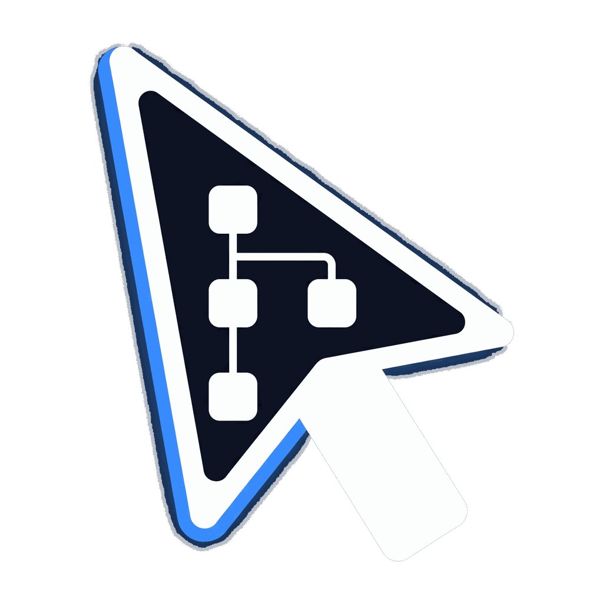
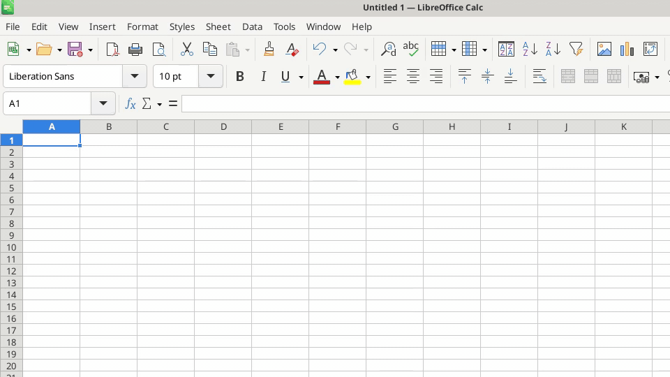
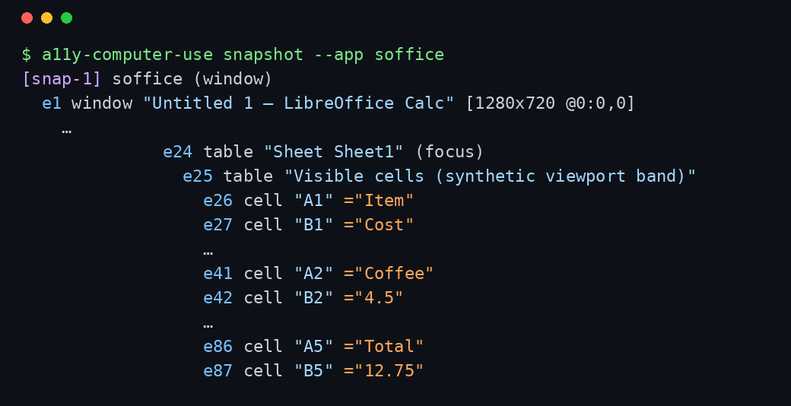
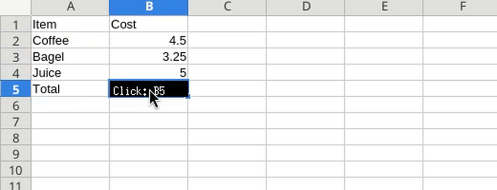

<h1 align="center"><br>a11y-computer-use</h1>

<p align="center">Computer use for AI agents. Clicks real UI elements, not guessed pixels.</p>

<p align="center">
  <a href="https://pypi.org/project/a11y-computer-use/"></a>
  <a href="https://github.com/Perception-Dynamics-Inc/a11y-computer-use/actions/workflows/ci.yml"></a>
  <a href="https://pypi.org/project/a11y-computer-use/"></a>
  <a href="./LICENSE"></a>
</p>

<p align="center">
  
  <br><sub>Real time, Linux, LibreOffice Calc, overlay on. <a href="docs/assets/demo-calc.mp4">MP4</a></sub>
</p>

The model reads the app's accessibility tree and says `click e87`.

The click goes through the accessibility API, so it lands on that cell.

One MCP server for macOS, Linux, Windows and Chrome.

## Install

```bash
pip install a11y-computer-use      # Linux needs python3-gi: docs/install.md
```

Add it to any MCP host (Claude Code: `claude mcp add a11y-computer-use -- uvx a11y-computer-use mcp`):

```json
{ "mcpServers": { "a11y-computer-use": { "command": "uvx", "args": ["a11y-computer-use", "mcp"] } } }
```

Or drive it from Python:

```python
from a11y_computer_use import safety, server
store = safety.PermissionStore(); store.set_tier("soffice", safety.Tier.FULL)
rt = server.Runtime(store=store)
print(rt.find("soffice", text="B5"))   # -> e87 cell "B5" [82x17 @0:115,260]
rt.click(ref="e87"); rt.type_text("=SUM(B2:B4)\n")
```

## Why

- **The accessibility tree, not screenshots.** The model gets a short text tree with refs. A stale ref is an error, not a wrong click.
- **Faster, with fewer errors.** No vision round trip per step. Several actions can go in one `act` call.
- **A safety layer.** You grant each app. Destructive clicks need confirmation. Password fields are never read or typed. Every action is logged.

## What the model sees

<p align="center"></p>

<p align="center"><br><sub>The overlay shows what the agent touches (Linux X11, <a href="docs/linux-port.md#visible-actions-x11-prototype">settings</a>).</sub></p>

## Platforms

| Platform | Backend | Status | Tested in CI |
|---|---|---|---|
| Linux | AT-SPI2 | Full on X11. Wayland: observe and press only | Live, Xvfb + openbox |
| macOS | AX | Full | Hermetic suite; live on a granted Mac |
| Windows | UIA | Partial: snapshot, press, set_value, type, keys | Live, Notepad |
| Browser | Chrome DevTools Protocol | Full | Live, headless Chromium |

## How it compares

From each project's public README and docs, October 2026. No speed claims until a head-to-head has run.

| | a11y-computer-use | Hermes + cua-driver | OpenComputerUse |
|---|---|---|---|
| Sees the app as | Accessibility tree, OCR fallback | Tree, numbered screenshot, or vision | Screenshot per action, tree on request |
| Batched actions | `act` | `run_steps`, `run_script` | `run_recipe` with a decision model |
| Runs in the background | Ref actions leave the pointer alone | Yes | Yes, per-app sessions |
| Watch it work | Overlay, Linux X11 | Overlay cursor, off on Linux X11 | Halo and gliding cursor, macOS |
| Permission layer | Per-app grants, confirm, audit log | Approval gate on input actions | OS permissions; keys for HTTP access |
| License | Apache-2.0 | MIT | MIT |

What we don't do yet:
- Coordinate input on Wayland.
- Most of Windows: ref re-resolution, capture, coordinate input.
- Private per-app displays, and phones.
- Apps with no accessibility tree get OCR refs, not real elements.

## Docs

[Install](docs/install.md) · [Tools](docs/tools.md) · [Platforms](docs/platforms.md) · [Comparison](docs/comparison.md) · [Safety](docs/safety.md) · [Embed it](docs/embedding.md) · [Linux](docs/linux-port.md) · [Windows](docs/windows-port.md) · [Browser](docs/browser-backend.md) · [Benchmarks](docs/benchmark.md) · [All docs](docs/README.md) · [Changelog](CHANGELOG.md) · [Contributing](CONTRIBUTING.md) · [Security](SECURITY.md)

Apache-2.0. Copyright 2026 Perception Dynamics, Inc.
