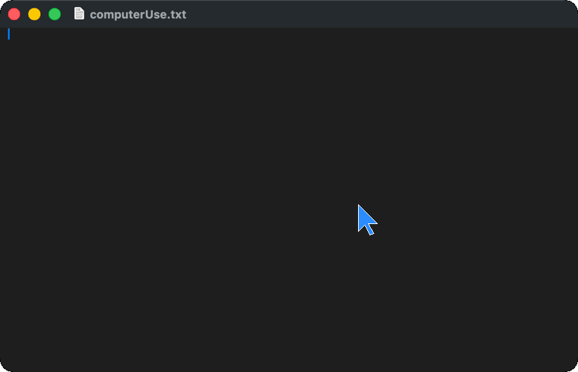

# a11y-computer-use docs

Start here. The top-level [README](../README.md) is a short landing page; the detail lives in these files.

## Start

- [Install](./install.md): pip, uvx, the Linux system packages, and MCP host setup
- [What the model sees, and the tools](./tools.md)
- [Platforms](./platforms.md): what works on macOS, Linux, Windows, and the browser
- [Safety](./safety.md): grants, the confirmation gate, password fields, the audit log
- [Embed it](./embedding.md): Python API, provider adapters, the agent loop, voice, missions
- [Comparison with other approaches](./comparison.md)

## Guides

[Agent loop](./agent-loop.md) · [a11y-agent](./agent.md) · [Agent models](./agent-models.md) · [Missions](./missions.md) · [Permissions](./permissions.md) · [Coexist](./coexist.md) · [Concurrency](./concurrency.md) · [Reporting](./reporting.md) · [Voice](./voice.md) · [WebMCP](./webmcp.md) · [OCR refs](./ocr-refs.md) · [macOS menus and dialogs](./macos-primitives.md) · [Adapters](./provider-adapters.md) · [Observation cost](./observation-cost.md) · [Benchmark](./benchmark.md) · [Benchmark results](./benchmarks/) · [Production](./production.md) · [Browser backend](./browser-backend.md) · [Linux](./linux-port.md) · [Windows](./windows-port.md) · [Real-desktop test bed](./box-testbed.md) · [CI](./ci.md) · [Decision records](./decisions/) · [Changelog](../CHANGELOG.md) · [Contributing](../CONTRIBUTING.md)

## From the previous README

These lines were the README introduction before the 2026-10-17 rewrite. They are kept here unchanged apart from link paths.

Computer use for AI agents that clicks real UI elements instead of guessed pixels. The model reads a pruned accessibility tree and says `click e14`. Works on macOS, Windows, Linux, and Chromium, through one MCP server.

> 0.4.3 captures 100x faster on macOS 26 (screencapture, per-window OCR that ignores covering apps). 0.4.2 closes the first three agent-filed issues (file dialogs by address, no whole-display OCR under an app's grant), refuses to fight the user for an app (`user_active`), and asks permission through a real macOS alert. 0.4.0: the user keeps working while the agent works ([docs/coexist.md](./coexist.md)).

Earlier banner: [assets/banner.png](./assets/banner.png).

Apache-2.0. Copyright 2026 Perception Dynamics, Inc.
