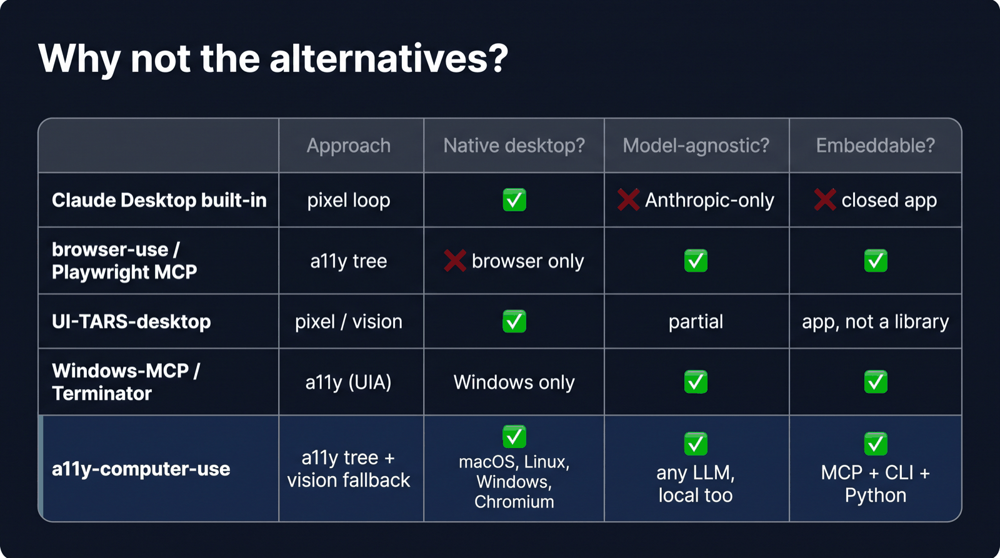

# Comparison with other approaches

> Moved here from the top-level README on 2026-10-17. The README is now a short landing page.

## Why not the alternatives

| | Approach | Native desktop | Any model | Embeddable |
|---|---|---|---|---|
| Claude Desktop built-in | pixel loop | ✅ | ❌ | ❌ |
| browser-use, Playwright MCP | a11y tree | ❌ browser only | ✅ | ✅ |
| UI-TARS-desktop | pixel / vision | ✅ | partial | app |
| Windows-MCP, Terminator | a11y (UIA) | Windows only | ✅ | ✅ |
| **a11y-computer-use** | a11y tree + vision fallback | ✅ macOS, Linux, Windows*, Chromium | ✅ local too | ✅ MCP, CLI, Python |

Same planner, 13 browser tasks, one round: refs finished 13/13 with 0 misclicks for $7.04; screenshot coordinates finished 7/13 with 27 misclicks for $11.74 ([full results](./benchmarks/h2h-2026-09-02.md)). Run it yourself with `a11y-computer-use bench h2h`.
