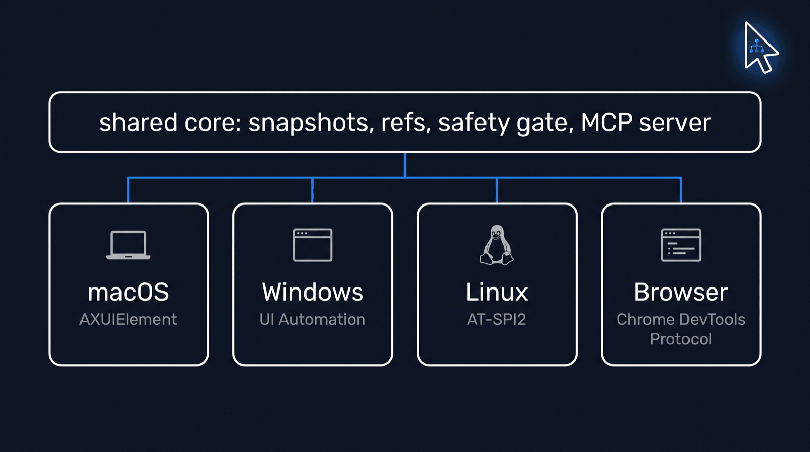

# Platforms

> Moved here from the top-level README on 2026-10-17. The README is now a short landing page.

## Platforms

| | Observe | Ref actions | Type, keys | Coordinates, screenshot | Verified |
|---|---|---|---|---|---|
| macOS (AX) | ✅ | ✅ | ✅ | ✅ | live on a granted Mac |
| Linux (AT-SPI2) | ✅ | ✅ | ✅ | ✅ X11, ❌ Wayland | CI + real desktop VM |
| Browser (CDP) | ✅ | ✅ | ✅ | ✅ | CI, headless Chrome |
| Windows (UIA)* | ✅ | ◐ press only | ✅ | ❌ | CI, Notepad |

\*Windows is partial: ref re-resolution, capture, and coordinate input are not implemented yet. Exact gates per platform: [docs/ci.md](./ci.md), [docs/windows-port.md](./windows-port.md), [docs/linux-port.md](./linux-port.md).

Linux GTK2 limitation: HexChat 2.16.2 has been reported as listed and focusable without an AT-SPI tree. Snapshot, find, and menus then return `no_accessibility_bridge`. See the [GTK2 bridge prerequisites and known limitation](./linux-port.md#gtk2-hexchat-bridge-limitation).
