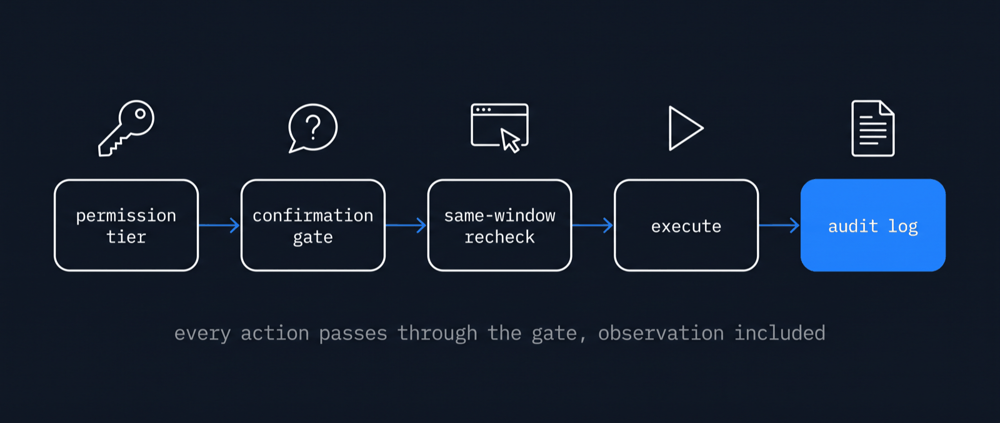

# Safety

> Moved here from the top-level README on 2026-10-17. The README is now a short landing page.

## Safety

- Per-app grants (`read`, `click`, `full`) in `~/.a11y-computer-use/permissions.json`. No tool can grant itself access: `grant_app` records only what the user accepted in the host's own dialog, or the user runs `a11y-computer-use grant <app> <tier>`.
- The macOS grants come to the user: a permission error opens the system dialog and the exact settings pane and names the host app ([docs/permissions.md](./permissions.md)).
- Clicks on destructive labels ask the host to confirm. No confirmation channel means the click is blocked.
- Password fields are never read, typed into, or clicked. Every action is checked against the frontmost window right before it fires.
- Everything is logged to `~/.a11y-computer-use/audit/` as JSONL, with secrets redacted.

Report security issues privately: [SECURITY.md](../SECURITY.md).
